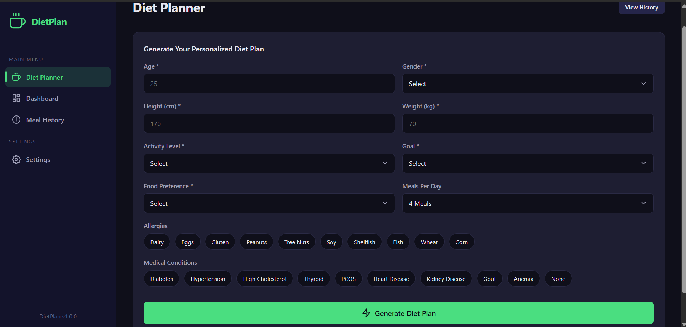

<div align="center">

# 🥗 DietPlan

### Personalized Diet Recommendation System

A rule-based nutrition recommendation system that generates personalized diet plans based on user health metrics, dietary preferences, allergies, and medical conditions.


</div>

---

# 📖 Overview

DietPlan is a web-based personalized diet recommendation system developed using **FastAPI**, **MongoDB Atlas**, **Plotly**, and **JavaScript**.

The application analyzes user information such as:

- Age
- Gender
- Height
- Weight
- Activity Level
- Goal
- Food Preference
- Allergies
- Medical Conditions

Based on these inputs, it calculates:

- BMI
- BMR
- TDEE
- Daily Calories
- Macronutrients

Finally, it generates a personalized diet plan consisting of:

- 🍳 Breakfast
- 🍛 Lunch
- 🍎 Snacks
- 🍲 Dinner

The generated recommendations are stored in **MongoDB Atlas** and visualized through an interactive Plotly dashboard.

---

# ✨ Features

## 🥗 Diet Recommendation

- Personalized meal planning
- BMI Calculator
- BMR Calculator
- TDEE Calculator
- Daily Calorie Calculator
- Macronutrient Calculator
- Water Recommendation
- Nutrition Score

---

## 🍽 Meal Planning

- Breakfast
- Lunch
- Snacks
- Dinner

---

## 🔍 Food Filtering

### Food Preferences

- Vegetarian
- Vegan
- Non-Vegetarian
- Keto
- Mediterranean
- Low-Carb

### Allergies

- Dairy
- Eggs
- Gluten
- Peanuts
- Tree Nuts
- Soy
- Shellfish
- Fish
- Wheat
- Corn

### Medical Conditions

- Diabetes
- Hypertension
- High Cholesterol
- Thyroid
- PCOS
- Heart Disease
- Kidney Disease
- Gout
- Anemia

---

## 📊 Dashboard Features

- BMI Indicator
- BMR
- TDEE
- Daily Calories
- Water Recommendation
- Nutrition Score
- Macronutrient Doughnut Chart
- BMI Gauge
- Daily Calories Gauge
- Meal-wise Calories
- Nutrition Balance Radar
- Meal Recommendation Table

---

# 🏗️ System Workflow

```text
User Inputs
      │
      ▼
Health Calculations
(BMI • BMR • TDEE)
      │
      ▼
Nutrition Calculations
(Calories • Protein • Carbs • Fat)
      │
      ▼
Rule-Based Recommendation Engine
      │
      ▼
Food Filtering
(Allergies • Medical Conditions • Food Preference)
      │
      ▼
Personalized Diet Plan
      │
      ▼
MongoDB Atlas
      │
      ▼
Interactive Plotly Dashboard
```

---

# 🛠️ Technology Stack

| Category | Technologies |
|-----------|--------------|
| Frontend | HTML5, CSS3, JavaScript |
| Backend | Python, FastAPI, Pydantic, Uvicorn |
| Database | MongoDB Atlas, PyMongo |
| Visualization | Plotly |
| Analytics | Microsoft Power BI |
| Data Processing | Pandas |

---

# 📂 Project Structure

```text
DietPlan
│
├── backend
│   ├── app
│   │   ├── database
│   │   ├── routes
│   │   ├── schemas
│   │   ├── services
│   │   └── main.py
│   │
│   └── scripts
│
├── frontend
│   ├── css
│   ├── js
│   └── index.html
│
├── assets
│
├── powerbi
│   └── Nutri.pbix
│
├── PPT
│
├── requirements.txt
├── README.md
└── start.bat
```

---

# 🚀 Installation

## Clone Repository

```bash
git clone https://github.com/YOUR_USERNAME/DietPlan.git
cd DietPlan
```

---

## Install Dependencies

```bash
pip install -r requirements.txt
```

---

## Configure Environment

Create a `.env` file inside the `backend` folder.

```env
MONGODB_URI=your_connection_string
DATABASE_NAME=DietPlan
```

---

## Start Backend

```bash
cd backend
uvicorn app.main:app --reload
```

---

## Open Frontend

Open

```
frontend/index.html
```

or run it using **Live Server**.

---

# 📸 Application Screenshots

## 🥗 Diet Planner



---

## 📊 Plotly Dashboard


---

# 📈 Power BI Nutrition Analytics

The repository also includes a standalone **Power BI dashboard** created using an **Excel nutrition dataset** for nutritional analysis.

It contains three dashboards:

### 📋 Nutrition Overview

- Total Foods
- Average Calories
- Average Protein
- Average Fat
- Average Carbohydrates
- Average Fiber


---

### 💊 Vitamin Analysis

- Vitamin A
- Vitamin B Complex
- Vitamin C
- Vitamin D
- Vitamin E
- Vitamin K


---

### 🍎 Food Insights

- Food Group Analysis
- Protein Analysis
- Fat Analysis
- Dietary Fiber Analysis
- Calorie Distribution


---

# 🔮 Future Enhancements

- User Authentication
- Weekly Diet Plans
- Monthly Reports
- PDF Export
- Workout Recommendation
- AI-based Recommendation Engine
- Mobile Application

---

# 👨‍💻 Author

**Bathala Anjith Kumar**

Computer Science & Engineering (AI & ML)

---

<div align="center">

### ⭐ If you found this project useful, please consider giving it a Star!

<<<<<<< HEAD
</div>
=======
</div>
>>>>>>> 32bf3cb (ReadME)
