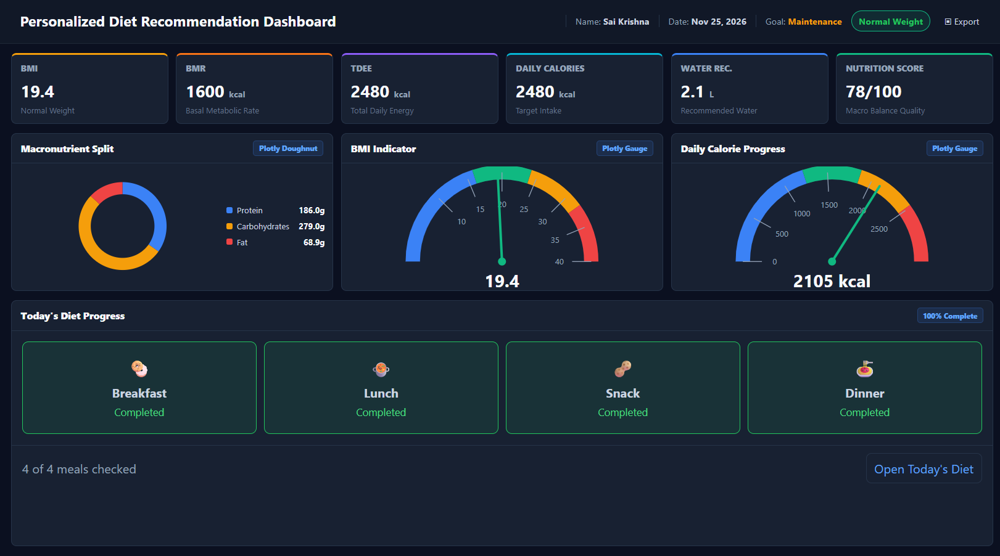
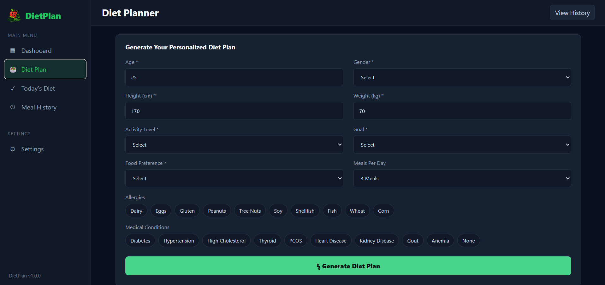
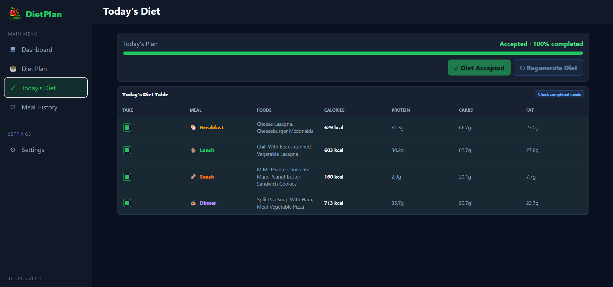
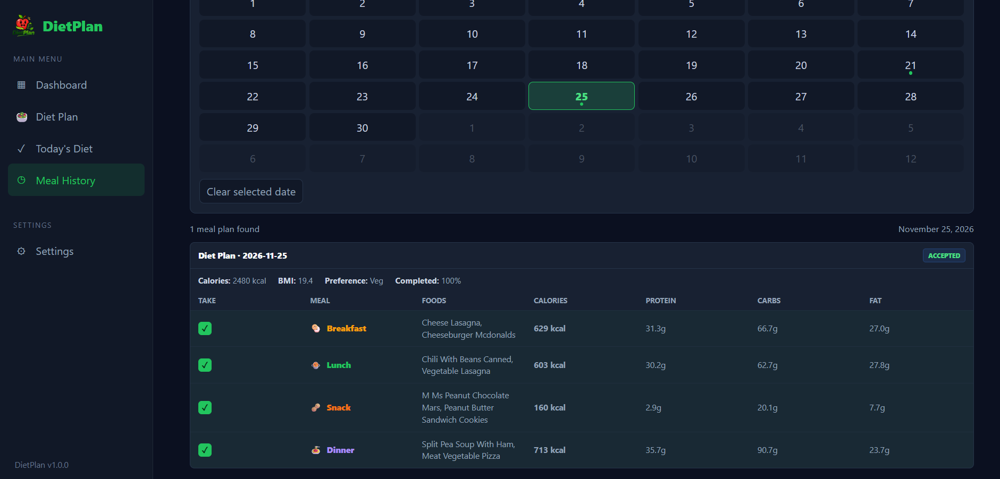
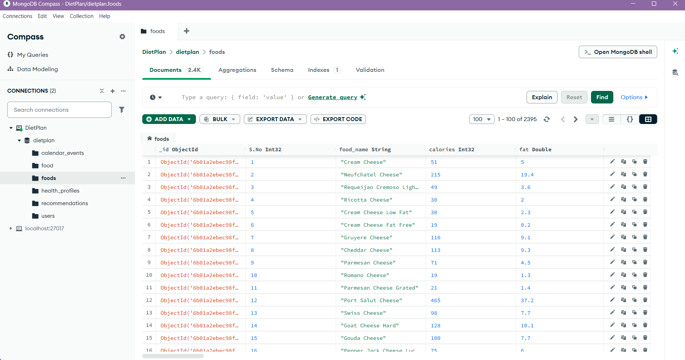
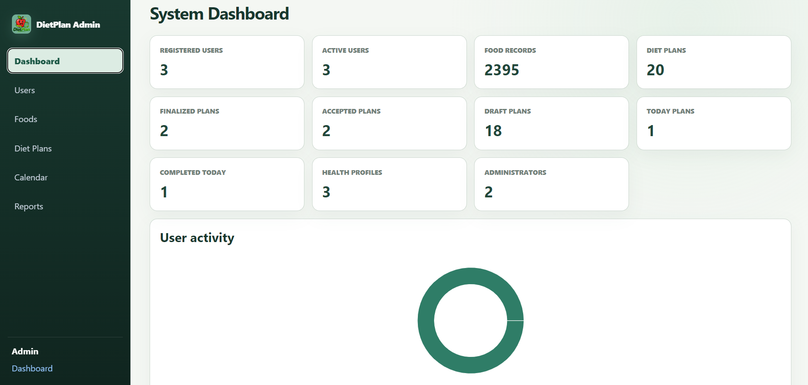
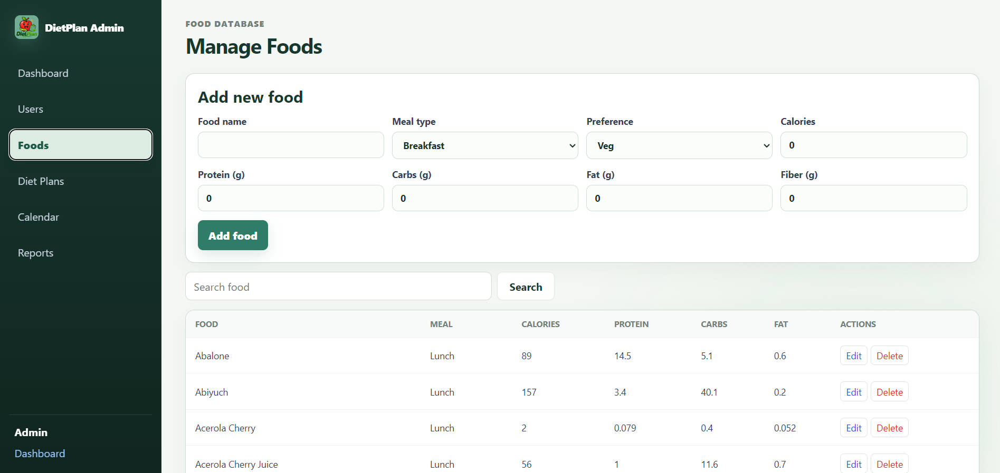
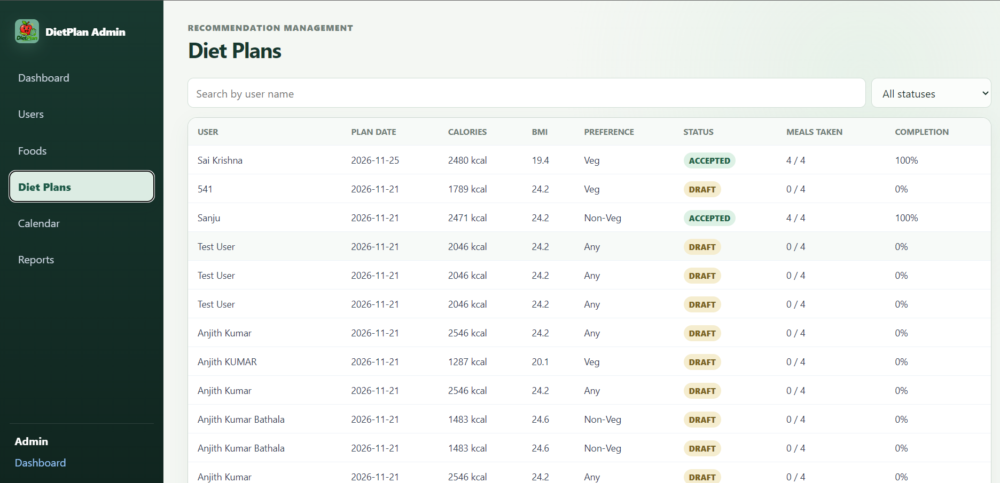
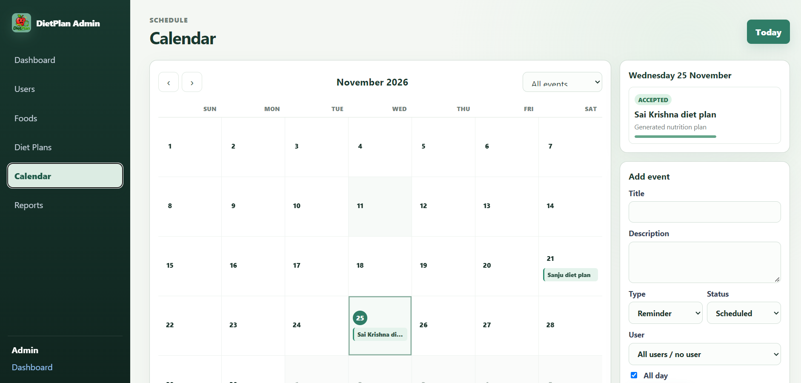
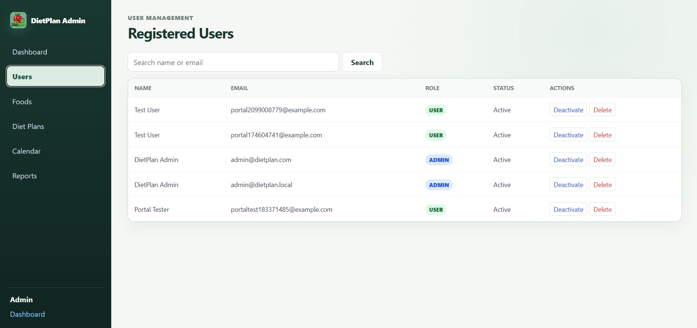

# NutriAI — Personalized Diet Planning

NutriAI is a web application for creating and tracking personalized daily meal plans. It combines a FastAPI backend, MongoDB persistence, and separate React interfaces for users and administrators. Its scoring-based meal planner selects foods from the project dataset and considers nutrition targets, food preferences, allergies, and supported medical-condition adjustments.

> **Health notice:** NutriAI is an informational planning tool, not medical advice or a substitute for care from a qualified health professional. Recommendations and food data should be reviewed before use, especially when allergies or medical conditions are involved.

## At a glance

- **User portal:** profile and health metrics, nutrition dashboard, diet-plan generation, today's meals, completion checklist, and meal history.
- **Admin portal:** usage dashboard, user and food management, diet-plan monitoring, calendar, and nutrition reports.
- **Backend:** REST API with authentication, profile, food, recommendation, dashboard, user, and admin routes.
- **Data:** MongoDB collections for users, health profiles, foods, recommendations, and calendar events.
- **Optional reporting:** Power BI report file in `powerbi/Nutri.pbix`.

## Screenshots

### User portal

| Dashboard | Diet plan |
| --- | --- |
|  |  |

| Today's diet | Meal history |
| --- | --- |
|  |  |

| Nutrition overview | Food insights |
| --- | --- |
|  |  |

| Vitamin analysis | Additional dashboard |
| --- | --- |
|  |  |

### Admin portal

| Admin dashboard | Food details |
| --- | --- |
|  |  |

| Diet plans | Calendar |
| --- | --- |
|  |  |

| User details | |
| --- | --- |
|  | |

## Project layout

```text
.
├── backend/
│   ├── app/
│   │   ├── database/       # MongoDB client, collections, and setup
│   │   ├── dependencies/   # Authentication and authorization
│   │   ├── routes/         # FastAPI route modules
│   │   ├── schemas/        # Request and response models
│   │   └── services/       # Nutrition calculations and meal planning
│   ├── scripts/            # Admin, food import, and dataset utilities
│   └── requirements.txt
├── user-frontend/          # React + Vite user application
├── admin-frontend/         # React + Vite admin application
├── frontend/               # Static/legacy frontend served by the API
├── Dataset/                # Food.csv and Food.xlsx source data
├── assets/                 # Screenshots used in this README
├── Logo/                   # Project logo
├── powerbi/                # Power BI report and related assets
├── PPT/                    # System architecture presentation
├── setup.bat               # Installs Python and frontend dependencies
└── start.bat               # Starts the backend and both portals
```

## Technology

- **Backend:** Python 3.10+, FastAPI, Pydantic, Uvicorn, PyMongo, and JWT/bcrypt authentication.
- **Frontend:** React, React Router, Vite, and Recharts.
- **Database:** MongoDB (local or MongoDB Atlas).
- **Analytics:** Power BI Desktop can open the included `.pbix` report.

The meal-planning service uses calorie and macro targets to score candidate foods. It filters candidates by meal type, preference, allergy, and supported condition rules, then selects the best-scoring options. BMI, BMR, TDEE, calorie goals, macro targets, and a water-intake estimate are also calculated by backend services.

## Run locally (Windows)

### Requirements

- Python 3.10 or later
- Node.js and npm compatible with the Vite version in the frontend package files
- A reachable MongoDB instance (MongoDB Atlas or local MongoDB)

### 1. Install dependencies

From the repository root, run:

```bat
setup.bat
```

The setup script installs Python requirements and the dependencies for both React applications. It also creates local `.env` files from the provided examples when they are missing.

### 2. Configure MongoDB and secrets

Edit `backend/.env` and set `MONGODB_URI` to your MongoDB connection string. The example database name is `nutriai`. Before using the app beyond a local demo, replace `SECRET_KEY` with a long, unique secret.

The backend settings are:

```env
MONGODB_URI=mongodb://localhost:27017
DATABASE_NAME=nutriai
SECRET_KEY=replace-with-a-long-random-secret
ALGORITHM=HS256
ACCESS_TOKEN_EXPIRE_MINUTES=60
DEMO_MODE=true
```

For Atlas, use the connection URI from your Atlas cluster instead of the local URI. Keep credentials and real secrets out of source control.

The frontend environment examples point at the local API:

```env
VITE_API_BASE_URL=http://127.0.0.1:8000
```

The admin portal also supports `VITE_DEMO_MODE` and an optional `VITE_POWERBI_URL` for an approved Power BI embed URL. Do not put private embed tokens or credentials in frontend environment variables.

> **Demo mode:** `DEMO_MODE=true` bypasses normal backend authentication and supplies demo user/admin identities. Use it only for local demonstrations; set it to `false` and configure a strong secret for authenticated use. The frontend demo setting does not replace backend authentication.

### 3. Start the application

Run:

```bat
start.bat
```

The script starts the API and both Vite development servers and opens the portals in your browser.

| Service | Local address |
| --- | --- |
| User portal | <http://127.0.0.1:5173> |
| Admin portal | <http://127.0.0.1:5174> |
| API root | <http://127.0.0.1:8000> |
| Swagger UI | <http://127.0.0.1:8000/docs> |
| ReDoc | <http://127.0.0.1:8000/redoc> |
| Health check | <http://127.0.0.1:8000/health> |

MongoDB must be reachable for features that read or write application data. The backend can start without a working database connection, but database-backed operations will not work until connectivity is restored.

### Start services manually

Open separate terminals from the project root.

```powershell
# Backend
cd backend
python -m pip install -r requirements.txt
uvicorn app.main:app --reload --host 127.0.0.1 --port 8000
```

```powershell
# User portal
cd user-frontend
npm install
npm run dev -- --host 127.0.0.1 --port 5173
```

```powershell
# Admin portal
cd admin-frontend
npm install
npm run dev -- --host 127.0.0.1 --port 5174
```

## Admin account

With `DEMO_MODE=false` and a configured MongoDB connection, create or promote an administrator using the backend script:

```powershell
$env:ADMIN_NAME = "DietPlan Admin"
$env:ADMIN_EMAIL = "admin@example.com"
$env:ADMIN_PASSWORD = "use-a-unique-password"
python backend\scripts\create_admin.py
```

The script prompts for any values not supplied as environment variables. Use a password of at least eight characters. Public registration creates normal user accounts; do not make an account an administrator by changing client-side settings.

## Main capabilities

### User portal

- Create an account and sign in when demo mode is disabled.
- Maintain account and health-profile details.
- View BMI, BMR, TDEE, calorie goals, and nutrition information.
- Generate a daily plan based on health metrics, goal, activity level, food preference, allergies, and supported medical-condition adjustments.
- Review today's meals, accept a plan, regenerate a plan, and track meal completion.
- View previous plans in meal history.

### Admin portal

- Review system metrics and registered users.
- Create, edit, and remove food records.
- Monitor generated diet plans and their completion.
- Manage calendar events.
- View nutrition and food reports, with optional Power BI embedding.

## API overview

Interactive API documentation is available at `/docs` while the backend is running. The API includes these route groups:

| Prefix | Purpose |
| --- | --- |
| `/auth` | Registration, login, and current-user information |
| `/dashboard` | User dashboard and chart data |
| `/profile` | Health-profile operations |
| `/foods` | Food listing, search, categories, and details |
| `/recommendation` | Generate and manage recommendations |
| `/users` | User profile, account, today's plan, checklist, and history |
| `/admin` | Admin dashboard, users, foods, calendar, and recommendations |
| `/health` | Service and MongoDB connectivity status |

## Data and utilities

- `Dataset/Food.csv` and `Dataset/Food.xlsx` contain food dataset source files.
- `backend/scripts/import_foods.py` imports food records.
- `backend/scripts/preprocess_food_dataset.py` preprocesses the food dataset.
- `backend/scripts/create_admin.py` creates or promotes an administrator.
- MongoDB collections used by the backend include `users`, `health_profiles`, `foods`, `recommendations`, and `calendar_events`.

## Power BI and architecture files

- Open `powerbi/Nutri.pbix` using Microsoft Power BI Desktop.
- The admin portal can display a Power BI report when `VITE_POWERBI_URL` is configured with an approved embed URL.
- `PPT/DietPlan-System-Architecture.pptx` contains the system architecture presentation.

## Development checks

Build either frontend from its directory:

```powershell
npm run build
```

Lint either frontend:

```powershell
npm run lint
```

Backend dependencies and test tooling are listed in `backend/requirements.txt`; run the checks appropriate to your local environment.

## Security and privacy

- Never commit `.env` files, database credentials, JWT secrets, or private embed tokens.
- Disable demo mode and use a strong unique `SECRET_KEY` before exposing the API beyond a local demo.
- Configure MongoDB network access and user permissions appropriately.
- Food and nutrition recommendations are informational and may not be suitable for an individual's clinical needs.
